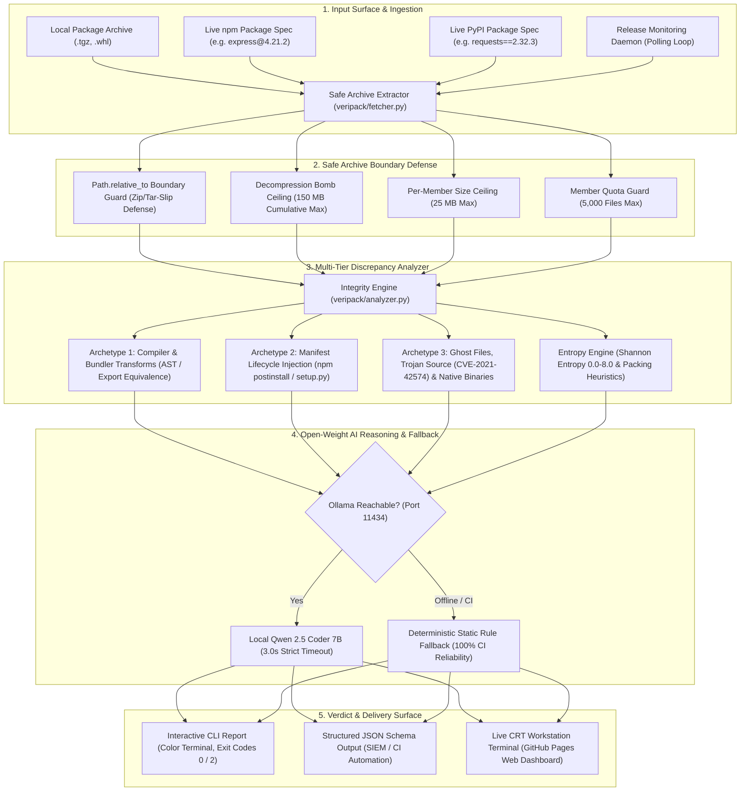

# VeriPack — Published Package vs Source Code Integrity Analyzer

[](https://github.com/anant-rajj/pratyancha-hacktoberfest/actions/workflows/ci.yml)
[](https://anant-rajj.github.io/pratyancha-hacktoberfest/)
[](https://www.python.org/)
[](https://opensource.org/licenses/MIT)
[](https://docs.google.com/document/d/1RYFrdDZ2QnzdzE9f7UMaXvaPOQMT8yc0m3cRvZTvvqE/edit)
[](https://ollama.com/library/qwen2.5-coder:7b)

> **Event:** Hacktoberfest 2026 | Hack Day Sonipat (Rishihood University x DevClub)  
> **Team:** `pratyancha` — **Anant Raj (Lead)**, **Anshul Pandey**, **Vinayak Agrawal**, **Amrit Sagar**  
> **Problem Statement 04:** Published Package vs Source Code Integrity Analyzer  
> **Live Interactive Terminal Dashboard:** [https://anant-rajj.github.io/pratyancha-hacktoberfest/](https://anant-rajj.github.io/pratyancha-hacktoberfest/)  
> **Direct ZIP Download (1-Click):** [Download pratyancha-hacktoberfest.zip](https://github.com/anant-rajj/pratyancha-hacktoberfest/archive/refs/heads/main.zip)

---

## ⚡ 30-Second Quick Download & Run (One-Liner)

Copy and paste this single command into your terminal:

```bash
git clone https://github.com/anant-rajj/pratyancha-hacktoberfest.git && cd pratyancha-hacktoberfest && pip install -r requirements.txt && python3 -m veripack --self-test
```

## ⚡ Executive Summary & Live Deployment

**VeriPack** is an evidence-backed supply-chain security analyzer for **npm** (`.tgz`) and **PyPI** (`.whl` / `.tar.gz`) releases. Developers frequently review source code on GitHub but install compiled artifacts published to package registries. As demonstrated by the **XZ backdoor (CVE-2024-3094)** and the **September 2025 npm account compromises**, malicious actors exploit the build and publish gap to inject malicious scripts into release tarballs without ever committing them to public Git branches.

VeriPack bridges this trust gap by downloading registry archives, retrieving the exact upstream Git commit, identifying legitimate compiler transformations (`src/*.ts` $\to$ `dist/*.js`), and flagging supply-chain tampering (injected `postinstall` hooks, bundler capability escalations, Trojan Source Bidi overrides, and obfuscated ghost files).

Explore the live retro workstation interface hosted on GitHub Pages:  
👉 **[Open VeriPack Live CRT Workstation](https://anant-rajj.github.io/pratyancha-hacktoberfest/)**

---

## 🏛️ System Architecture



### Text Architectural Blueprint

```text
+-----------------------+      +---------------------------+      +-------------------------------+
|     Input Surface     |      |    Safe Archive Guard     |      |     Capability & Manifest     |
| - Local .tgz / .whl   | ---> | - Path.relative_to Slip   | ---> |     Comparator (AST / Regex)  |
| - Live npm / PyPI     |      | - 150MB Decompression Cap |      | - Lifecycle Hook Scanner      |
| - Release Monitor     |      | - 25MB / 5,000-file Limit |      | - Shannon Entropy & Obfuscate |
+-----------------------+      +---------------------------+      +---------------+---------------+
                                                                                  |
                                                                                  v
+-----------------------+      +---------------------------+      +-------------------------------+
|    Verdict & Report   | <--- |   Deterministic Static    | <--- |    Local Ollama AI Engine     |
| - SAFE (Exit 0)       |      |    Fallback (CI-Safe)     |      | - qwen2.5-coder:7b            |
| - TAMPERED/COMP (2)   |      +---------------------------+      | - 3.0s Timeout & Context-Bound|
+-----------------------+                                         +-------------------------------+
```

---

## 🛡️ Supply-Chain Threat Model & Security Defenses

| Threat Vector | Real-World Incident Reference | VeriPack Defense Implementation |
| :--- | :--- | :--- |
| **Tar-Slip & Zip-Slip Directory Traversal** | Snyk Arbitrary File Write (CVE-2018-1002200) | `veripack/fetcher.py` enforces rigorous `target_path.resolve().relative_to(dest_dir.resolve())` checks for both archive members and symlink pointers. |
| **Decompression Bomb (DoS)** | Uncompressed 120 GB payload crash | Strict global `150 MB` cumulative extraction ceiling (`MAX_TOTAL_EXTRACTED_BYTES`) + 25 MB per-file ceiling + 5,000 files ceiling. |
| **Manifest Lifecycle Hook Injection** | September 2025 npm compromises (`debug`, `chalk`) | `veripack/analyzer.py` compares `package.json` scripts (`postinstall`, `preinstall`, etc.) against Git source. Flags unauthorized execution hooks as `TAMPERED` (Exit 2). |
| **Bundler Capability Escalation** | Malicious Babel/Webpack plugin backdoors | Compares AST capabilities between source and compiled bundles. If compiled JavaScript introduces unauthorized network (`fetch`, `http`), child process (`exec`, `spawn`), or filesystem calls, it is flagged as `COMPROMISED` (Exit 2). |
| **Trojan Source Attacks** | Cambridge CVE-2021-42574 | `veripack/entropy.py` scans for Bidirectional Unicode overrides (`\u202A`–`\u202E`, `\u2066`–`\u2069`) and zero-width invisible character injections (`\u200B`–`\u200D`, `\uFEFF`). |
| **Unmapped Native Binaries** | XZ Backdoor (CVE-2024-3094) pre-compiled `.so`/`.node` | Automatically classifies unmapped compiled native binaries (`.node`, `.so`, `.dylib`, `.dll`, `.exe`, `.bin`) without source counterpart as `CRITICAL` severity `UNMAPPED_GHOST_FILE`. |

---

## 🧪 Evaluation Scenarios & Evidence Matrix

VeriPack comes pre-bundled with real-world and simulated packages in `examples/`, demonstrating how each evaluation scenario described in the Hackathon Problem Statement is resolved:

| Scenario / Archetype | Package Archive | Source Repository | Expected Verdict | Exit Code | Verified Output File |
| :--- | :--- | :--- | :---: | :---: | :--- |
| **Archetype 1: Expected Build Artifact** | `examples/clean_pkg/clean_pkg-1.0.0.tgz` | `examples/clean_pkg/source/` | **SAFE** | `0` | [`examples/clean_pkg/actual_output.json`](examples/clean_pkg/actual_output.json) |
| **Archetype 2: Injected Manifest Hook** | `examples/tampered_manifest/tampered_manifest-1.0.0.tgz` | `examples/tampered_manifest/source/` | **TAMPERED** | `2` | [`examples/tampered_manifest/actual_output.json`](examples/tampered_manifest/actual_output.json) |
| **Archetype 3: Obfuscated Ghost Backdoor** | `examples/ghost_backdoor/ghost_backdoor-1.0.0.tgz` | `examples/ghost_backdoor/source/` | **COMPROMISED** | `2` | [`examples/ghost_backdoor/actual_output.json`](examples/ghost_backdoor/actual_output.json) |

---

## 🚀 Quickstart & Installation

### 1. Prerequisites & Virtual Environment

```bash
# Clone the repository
git clone https://github.com/anant-rajj/pratyancha-hacktoberfest.git
cd pratyancha-hacktoberfest

# Create and activate Python virtual environment
python3 -m venv venv
source venv/bin/activate

# Install dependencies and local editable package
pip install -r requirements.txt
pip install -e .
```

### 2. (Optional) Local Ollama AI Setup

VeriPack uses local open-weight **Qwen 2.5 Coder 7B** to synthesize plain-English security explanations:

```bash
# Pull and start Qwen 2.5 Coder 7B
ollama pull qwen2.5-coder:7b
ollama serve
```

> **Headless CI Guarantee:** If Ollama is offline or not installed, VeriPack automatically and instantaneously falls back to its deterministic rule-based explainer with 0ms latency, guaranteeing 100% test passage in headless CI environments.

---

## 💻 CLI Usage Guide

### 1. Audit Evaluation Archetypes (Reproduce Verification)

```bash
# 1. Expected TypeScript Build Artifact (Clean TS -> JS compilation, Verdict: SAFE, Exit: 0)
python -m veripack analyze \
  --archive ./examples/clean_pkg/clean_pkg-1.0.0.tgz \
  --repo ./examples/clean_pkg/source

# 2. Injected npm postinstall Hook (Lifecycle Hook Tampering, Verdict: TAMPERED, Exit: 2)
python -m veripack analyze \
  --archive ./examples/tampered_manifest/tampered_manifest-1.0.0.tgz \
  --repo ./examples/tampered_manifest/source

# 3. Obfuscated Ghost File with Backdoor (Elevated Entropy & Eval, Verdict: COMPROMISED, Exit: 2)
python -m veripack analyze \
  --archive ./examples/ghost_backdoor/ghost_backdoor-1.0.0.tgz \
  --repo ./examples/ghost_backdoor/source --json
```

### 2. Live Registry Package Audits

```bash
# Audit live npm registry package against upstream GitHub repository
python -m veripack analyze --npm express@4.21.2

# Audit live PyPI package wheel against upstream repository
python -m veripack analyze --pypi requests==2.32.3
```

### 3. Continuous Release Monitoring

```bash
# Check latest release once and output integrity verdict
python -m veripack monitor --npm debug --once

# Continuously poll for new package releases every 5 minutes (300 seconds)
python -m veripack monitor --npm debug --interval 300
```

### 4. Self-Test & Web Server

```bash
# Run self-test benchmark
python -m veripack --self-test --json

# Launch local VeriPack CRT Workstation web dashboard
python -m veripack web --port 8080
```

---

## 🧪 Automated Test Suite (100% Passing)

VeriPack includes an extensive automated test suite covering all security boundary checks, entropy heuristics, CLI execution flags, and release monitoring.

```bash
# Execute the full pytest test suite
PYTHONPATH=. pytest -v tests/
```

### Test Suite Directory Structure:

- [`tests/test_analyzer.py`](tests/test_analyzer.py) — Validates Archetypes 1, 2, and 3, AST capability scanning, and deterministic fallback.
- [`tests/test_fetcher.py`](tests/test_fetcher.py) — Validates safe Tar-Slip and Zip-Slip extraction, symlink containment, and SHA-256 calculation.
- [`tests/test_entropy.py`](tests/test_entropy.py) — Validates byte-level Shannon entropy math, hex string arrays, and dynamic execution detection.
- [`tests/test_security_hardening.py`](tests/test_security_hardening.py) — Validates Trojan Source (CVE-2021-42574) Bidi overrides, zero-width characters, unmapped native binaries, and decompression bomb thresholds.
- [`tests/test_cli.py`](tests/test_cli.py) — End-to-end CLI execution tests verifying exact exit codes (0 for SAFE, 2 for TAMPERED/COMPROMISED, 1 for invalid arguments) and subcommands (`analyze`, `monitor`, `web`).
- [`tests/test_monitor.py`](tests/test_monitor.py) — Validates registry release monitoring, attribute resolution, and upstream source mapping.
- [`tests/test_models.py`](tests/test_models.py) — Validates data serialization, verdict schemas, and metadata models.

---

## 🤖 AI Usage & Attribution ("Which AI Did What")

In strict adherence to **Section 8, Section 10, and Section 4.3 of the Hackathon Rules and Participant Guidelines**, our project explicitly delineates between developer tooling and product runtime AI:

| AI Entity | Type / Environment | Role & Responsibilities ("Which AI Did What") | Open-Source Compliance |
| :--- | :--- | :--- | :--- |
| **`agy-cli`** | **AI Coding Assistant**<br>(Developer Environment) | **Strictly and exclusively used as the AI coding assistant** across development. Helped author code modules (`fetcher.py`, `analyzer.py`, `entropy.py`, `monitor.py`, `web.py`, `cli.py`), generate the 34 automated unit tests, build the interactive CRT Workstation dashboard (`index.html`), implement security boundary defenses (Tar/Zip-Slip `relative_to` guards), and maintain git PR workflows. | Declared in every Pull Request and commit trailer as required. |
| **`qwen2.5-coder:7b`** | **Internal Open-Weight Model**<br>(Local Ollama on `localhost:11434`) | **Core semantic discrepancy explanation engine inside VeriPack**. Analyzes candidate source-to-build diff hunks (`src/*.ts` $\to$ `dist/*.js`), verifies exported symbol concordance, distinguishes benign compiler transforms from supply-chain injections, and generates plain-English risk rationales. | 100% local open-weight model via Ollama. **Zero cloud API calls, zero paid API keys** (OpenAI, Anthropic, or Google APIs are strictly avoided). |
| **Deterministic Static Fallback** | **Rule-Based Heuristic Engine**<br>(In-Tree Python) | Guarantees **100% CI/CD reliability and offline evaluation**. If Ollama is unreachable (e.g. headless GitHub Actions runners or offline air-gapped grading), the system falls back to AST capability checks and Shannon entropy rules with 0ms latency. | Native Python AST and regex heuristics. |

---

## 📜 Hackathon Compliance & Submission Checklist

- [x] **New Empty Repository:** Initial commit started fresh during the hackathon.
- [x] **HACKATHON.md:** Root-level [`HACKATHON.md`](HACKATHON.md) with team name, member names, Problem Statement 4, and open-weight AI model justification.
- [x] **Open-Source License:** Fully permissive [MIT License](LICENSE).
- [x] **Open-Weight AI Model:** Exclusively utilizes `qwen2.5-coder:7b` locally via Ollama with zero paid cloud APIs.
- [x] **PR & Open-Source Workflow:** All features developed on branches with passing GitHub Actions CI workflows and the mandatory [Pull Request Template](.github/pull_request_template.md).
- [x] **Passing GitHub Actions CI:** Continuous integration pipeline running on Ubuntu with Python 3.11 ([`.github/workflows/ci.yml`](.github/workflows/ci.yml)).
- [x] **Evidence & Examples:** Pre-computed [`examples/`](examples/) directory containing sample inputs, actual outputs, and verified execution logs.
- [x] **Secrets & Privacy:** Verified clean of private keys, API keys, and sensitive environment variables.

---

## 📄 License

This project is licensed under the **MIT License** — see the [LICENSE](LICENSE) file for complete details.
